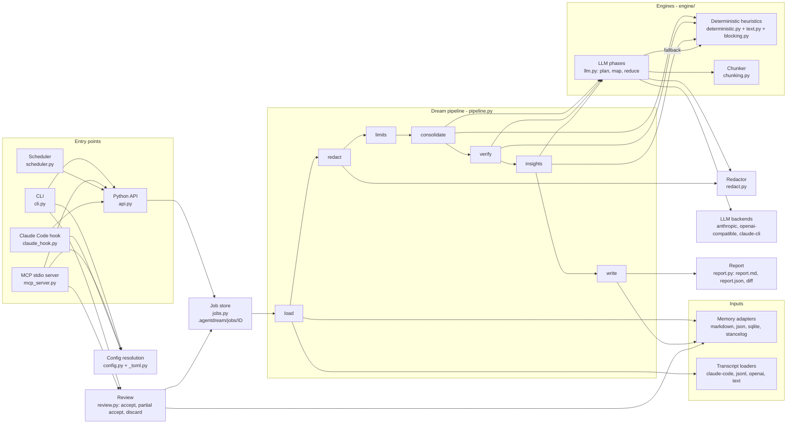
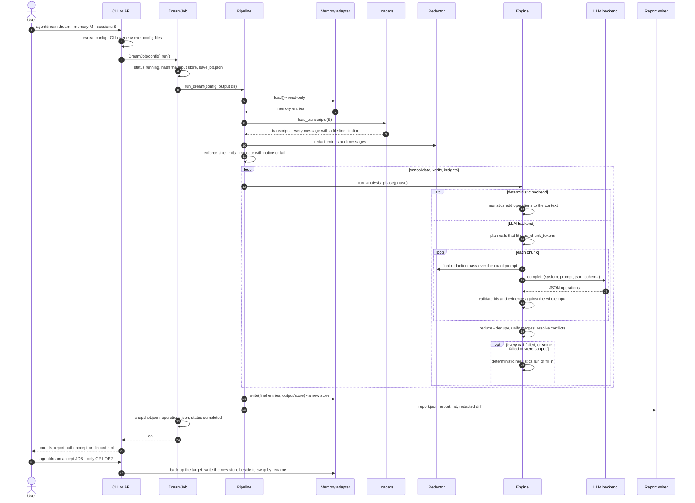
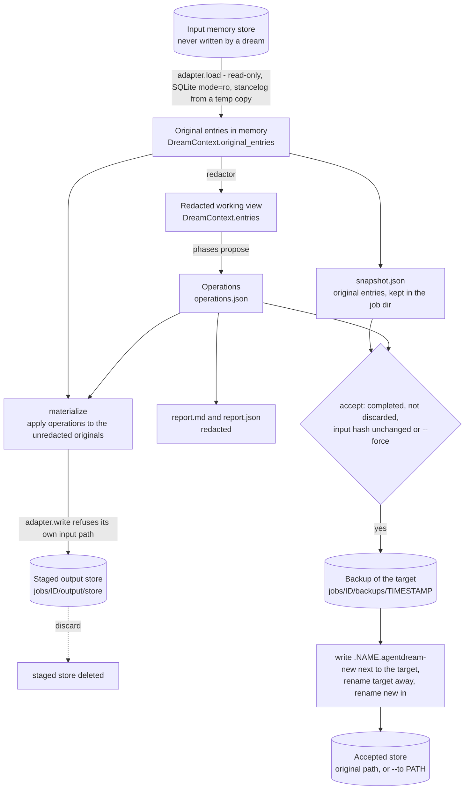
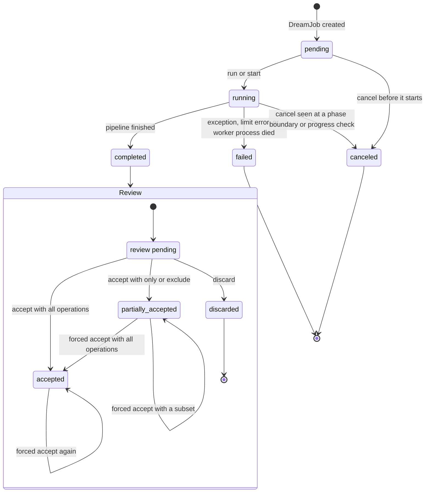

# agentdream architecture

This document explains how a dream runs, what every module is responsible for, the data model, how the
safety guarantees are enforced, and how to extend the system. Code references are to `src/agentdream/`.

* [Components](#components)
* [One dream, end to end](#one-dream-end-to-end)
* [Data flow: the input store is never modified](#data-flow-the-input-store-is-never-modified)
* [Job and review states](#job-and-review-states)
* [Module map](#module-map)
* [Data model](#data-model)
* [Operation types](#operation-types)
* [The pipeline phases](#the-pipeline-phases)
* [Engines: deterministic and LLM](#engines-deterministic-and-llm)
* [Chunking and map-reduce](#chunking-and-map-reduce)
* [Review: accept, partial accept, discard](#review-accept-partial-accept-discard)
* [Automation: scheduler and Claude Code hook](#automation-scheduler-and-claude-code-hook)
* [Extension points](#extension-points)
* [Safety guarantees](#safety-guarantees)
* [Concurrency and atomicity](#concurrency-and-atomicity)
* [Performance](#performance)
* [Failure modes](#failure-modes)

## Components



* **Entry points** turn user input into a `DreamConfig`. The CLI, MCP server and hook resolve
  configuration through `config.resolve()` (CLI > env > project file > user file > defaults); the Python
  API takes keyword arguments directly.
* **`DreamJob`** (`jobs.py`) owns one dream's lifecycle and persisted state; it calls `run_dream()`.
* **The pipeline** is an ordered list of named phases, each a plain function `fn(ctx: DreamContext)`.
* **Adapters** read a memory store (never writing to it) and write a *new* store in the same format.
  **Loaders** parse transcripts and keep a citation (`file:line` or `file#index`) on every message.
* **The redactor** scrubs secrets from everything that is analysed, sent to a model or quoted in a report.
* **Engines** propose operations. The deterministic engine is rule-based; the LLM engine plans token-budgeted
  calls, validates every proposal against the real store and transcripts, and merges results.
* **Report** renders `report.md` / `report.json` and a unified diff. **Review** applies all or some
  operations to a target store with a backup, or discards the staged output.

## One dream, end to end



## Data flow: the input store is never modified



A dream only ever *reads* the input. Its outputs (staged store, reports, job state) live under the job
directory (`$AGENTDREAM_HOME/jobs/<id>/` or `./.agentdream/jobs/<id>/`, or `--out`). Accepting re-derives
the final store from `snapshot.json` + the selected operations, so what is applied is exactly what was
reviewed — even if the staged copy was deleted.

## Job and review states



* `status` (`pending | running | completed | failed | canceled`) and `review`
  (`pending | accepted | partially_accepted | discarded`) are separate fields of `job.json`.
* A job left `running`/`pending` by a process that no longer exists is marked `failed` the next time
  it is loaded (`DreamJob.load` checks the recorded pid).
* `discard` on an unfinished job cancels it first; a discarded job can't be accepted; an accepted job
  can't be discarded (restore from its backup instead).

## Module map

| File | Responsibility |
|---|---|
| `__init__.py` | Public API re-exports (`dream`, `accept`, `DreamJob`, `Pipeline`, registries, models, ...). |
| `__main__.py` | `python -m agentdream` → `cli.main`. |
| `api.py` | `dream()` / `dream_async()` / `make_config()`: build a `DreamConfig`, run a `DreamJob`, optional apply. |
| `cli.py` | argparse CLI: `dream`, `status`, `list`, `show`, `accept`, `discard`, `cancel`, `schedule`, `serve-mcp`, `config`, `hook`, `install-claude-hook`, `uninstall-claude-hook`. |
| `config.py` | Config discovery (`.agentdream.toml`, `[tool.agentdream]`, user file), env vars, type coercion, precedence, source tracking. |
| `_toml.py` | `tomllib` → `tomli` → built-in TOML-subset parser (Python 3.10 without extras). |
| `context.py` | `DreamConfig` (all options), `DreamContext` (state shared by phases), `DreamCanceled`, `DreamLimitError`, sentence index. |
| `models.py` | `MemoryEntry`, `Message`, `Transcript`, `Evidence`, `Operation`, `apply_operations`, `resolve_dependencies`, stable ids. |
| `pipeline.py` | `Pipeline` (ordered, editable phases), built-in phases `load`, `redact`, `limits`, `write`, instruction handling, `materialize`, report sanitizing. |
| `engine/__init__.py` | `run_analysis_phase`: deterministic vs. LLM, full and partial fallback. |
| `engine/deterministic.py` | Heuristic consolidate / verify / insights with exact blocking and indexes. |
| `engine/llm.py` | Prompts, call planning (chunks), JSON repair, validation of proposals, reduce step. |
| `chunking.py` | Token estimates, lossless text splitting, greedy packing, transcript overlap. |
| `blocking.py` | Prefix-filtering candidate pairs for Jaccard thresholds, inverted index, cluster ordering. |
| `text.py` | Normalisation, tokens/stems, sentence splitting, claim extraction (subject / value / polarity / typed slots); memoised. |
| `redact.py` | Secret patterns, entropy check, Luhn card check, `Redactor` with per-kind counts. |
| `loaders.py` | Transcript formats, auto-detection, file/dir/glob expansion, chronological ordering. |
| `adapters/base.py` | `MemoryAdapter` interface; `_check_dest` refuses writes onto the input. |
| `adapters/markdown.py` | Markdown/text folder or file: entry per bullet/paragraph or per front-matter file; minimal re-rendering. |
| `adapters/jsonstore.py` | JSON / JSONL file or folder; keeps the input's shape (list, wrapped list, map, JSONL) and unknown fields. |
| `adapters/sqlite.py` | One table of entries; read-only connection; output = backup-API copy with the table rewritten. |
| `adapters/stancelog.py` | Optional [stancelog](https://github.com/systemagents-ai/stancelog) belief log (`stancelog:<path>`), imported lazily. |
| `adapters/__init__.py` | Adapter registry, auto-detection, `agentdream.adapters` entry points. |
| `backends/base.py` | `LLMBackend` interface, `http_post_json` (urllib). |
| `backends/builtin.py` | `deterministic`, `anthropic`, `openai` (compatible), `claude-cli`. |
| `backends/__init__.py` | Backend registry, aliases (`ollama`, `lmstudio`, ...), `agentdream.backends` entry points. |
| `jobs.py` | `DreamJob`: statuses, background thread, cancel (in-process and via `job.json`), persisted state, results. |
| `review.py` | `accept` (all / `only` / `exclude` with dependency closure, backup, atomic swap), `discard`. |
| `report.py` | Report sections and counts, markdown rendering, unified diff (per file for text stores). |
| `scheduler.py` | Idle / interval / every-N-sessions triggers with persisted state and injectable clock. |
| `claude_hook.py` | Claude Code hook: stdin payload, gating, locks, detached worker, settings.json installer. |
| `mcp_server.py` | JSON-RPC 2.0 MCP server over stdio (newline-delimited), six tools. |
| `util.py` | Atomic writes, tree hashing, durations, timestamps, token estimate. |

## Data model

```text
MemoryEntry(id, content, path=None, key=None, metadata={}, created_at=None, updated_at=None, source=None)
Message(role, content, timestamp=None, line_no=None, source_path=None, index=0)      # .citation -> "file:line"
Transcript(id, messages, source_path=None, format=None, metadata={})
Evidence(citation, quote, source_path, line_no, role, stance="supports" | "refutes" | "mentions", timestamp)
Operation(id, type, summary, reason, targets, remove, upsert, before, after, evidence,
          depends_on, kind, confidence, phase, origin, history)
```

* **Entry ids** come from the adapter and are stable while the store is unchanged: markdown
  `MEMORY.md#3` (third block) or the file path for front-matter files, JSON the object's `id` (or
  `file#n`), SQLite the `id` column, stancelog the belief subject. Metadata keys starting with `_` are
  adapter layout hints (`_order`, `_layout`, `_text_key`, ...) and are never shown in reports.
* **Citations** are `source_path:line_no` (1-based line of the JSONL record / text turn) or
  `source_path#index` when there is no line (e.g. a JSON array without line info).
* **An operation** is a reviewable change. Applying it removes `remove` ids and upserts `upsert` entries
  (`models.apply_operations`). `targets` are the entries it is *about*; `before` / `after` are display
  text; `depends_on` lists operations that produced an entry this one touches (so a partial accept is
  always consistent); `origin` is `deterministic` or the backend description; `history` keeps superseded
  values and alternative proposals.
* **Operation ids** are `"<type>-" + sha256(type, sorted(targets), after)[:8]` (`Operation.make_id`), so
  the same proposal gets the same id in every run and in chunked vs. unchunked runs. Collisions inside one
  dream get a `-2`, `-3` suffix.

## Operation types

| Type | Changes the store? | Meaning |
|---|---|---|
| `merge` | yes | Duplicates collapse into one entry (the newest / most informative wording); the others are removed. |
| `replace` | yes | Same subject, different value: the latest value wins, stale entries are removed (`kind="conflict"` when stances are opposite). |
| `correct` | yes | Transcript evidence contradicts the note; the note is rewritten with the proven value. Evidence required. |
| `insight` | yes (adds) | A new note from recurring patterns (mistakes, preferences, workflows). Evidence required. |
| `contradiction` | if it has new content | `kind="temporal"`: a stance changed over time — the latest stance becomes current with a one-line history. Without new content it is a **flag** for the reviewer (`kind="evidence"` / `"conflict"`). |

Report sections: Merged, Replaced (stale), Corrected, New insights, Contradictions (temporal ones counted
separately; `replace` with a `kind` also appears here), Unchanged count, Warnings & notices, Redactions,
Diff.

## The pipeline phases

`Pipeline.default()` is `load → redact → limits → consolidate → verify → insights → write`.

1. **load** — `get_adapter(memory, memory_format).load()` and `load_transcripts(sessions)`. Transcripts
   are ordered by first timestamp (or natural path order when some have none).
2. **redact** — copies of all entries and every message go through `Redactor`; the working view
   (`ctx.entries`) is redacted, `ctx.original_entries` is not. Counts per kind go to the report.
3. **limits** — `max_sessions` (keep the most recent), `max_bytes_per_transcript` (keep the most recent
   messages), `max_total_tokens` (drop the oldest sessions, then the oldest messages). `on_limit="fail"`
   raises `DreamLimitError` instead. Every truncation is a report notice.
4. **consolidate / verify / insights** — `run_analysis_phase(ctx, name)`; free-text `instructions` can
   skip phases (*"skip insights"*, *"only verify"*) and are passed to LLM prompts.
5. **write** — `materialize()` applies the operations to the **unredacted** originals (entries whose
   content only differs by redaction get their original text back), the adapter writes the new store into
   `output/store`, then `report.json` / `report.md` are written with a redacted diff.

`DreamContext.add_op()` assigns dependencies, de-duplicates ids and updates the working view, so later
phases see the consolidated store (verify checks the merged note, not both duplicates).

## Engines: deterministic and LLM

**Deterministic** (`engine/deterministic.py`, `text.py`):

* *consolidate*: duplicates are pairs with equal normalised text or high token-set overlap (Jaccard ≥ 0.75,
  or ≥ 0.5 with high sequence similarity, or near-containment), excluding pairs whose typed values
  (directions, numbers, on/off states) or polarity differ — those are staleness or contradiction questions.
  Connected components become merges. Claims (`subject is value`, `use / don't use X`, `X is better`) with
  the same subject and conflicting values become `replace` (latest by timestamp, else store order). Two
  subjects with the same head noun but a distinguishing qualifier on *both* sides ("the PokéCenter in
  Viridian City" / "... in Pewter City") are different things, never one stale value of the other;
  opposite preferences become temporal contradictions.
* *verify*: for each claim, transcript sentences mentioning its subject are scored: failure markers
  ("no PokéCenter here", "still can't find") refute the value they mention, confirmation markers ("found",
  "it is south of") support theirs, intent/belief sentences ("my notes say", "heading north") are ignored.
  A better-supported alternative value produces a `correct` with the strongest refuting and supporting
  lines as evidence; repeated refutation without an alternative produces a flag. Preference notes are
  compared with the latest transcript stance (temporal contradiction).
* *insights*: failure-marked sentences clustered by content overlap across sessions (recurring mistakes),
  preference statements repeated in ≥ `insight_min_sessions` sessions or reversed between sessions, and
  command sequences (`[tool] Bash: ...`, `` `cmd` `` spans) recurring across sessions.

**LLM** (`engine/llm.py`): one system prompt describing the operation types and rules, a per-phase task,
the (redacted) memory rendered with ids, and — for verify / insights — transcripts with a `[file:line]`
prefix on every message. The model must return `{"operations": [...]}`; `parse_json_loose` repairs code
fences, trailing commas, smart quotes, Python literals and truncated output. `convert_operations`
validates each proposal: allowed type for the phase, every target id exists (and was shown in this
chunk), citations resolve to real messages, quotes are checked against the cited message, corrections
need evidence, excerpted entries are read-only. Invalid parts are dropped or downgraded with a warning.

**Fallback** (`engine/__init__.py`): if every call of a phase fails (network, HTTP error, no parseable
JSON), the deterministic heuristics run for that phase. If only some calls failed, or `max_chunks`
capped the plan, the valid LLM operations are applied first and the heuristics then fill in over the
updated store. `DreamCanceled` and `DreamLimitError` propagate.

## Chunking and map-reduce

`plan_calls(ctx, phase)` turns a phase into model calls whose prompts fit `max_chunk_tokens` (estimated at
~4 characters per token, minus the system prompt and scaffolding):

* **consolidate** (memory only): if the store fits, one call. Otherwise entries are reordered so likely
  duplicates and same-subject notes are adjacent (`similarity_order`, via `blocking.cluster_order`) and
  packed into chunks.
* **verify / insights**: if memory + transcripts fit, one call. If the memory fits in half the budget,
  every transcript chunk is sent with the whole store. Otherwise each transcript chunk is paired with the
  entries it is relevant to (they share a *distinctive* token — one that is rare across the store, like a
  name, id or number); verify sends those entries in as many memory chunks as needed, insights sends the
  most relevant ones that fit as context.
* Transcript chunks overlap by `chunk_overlap` tokens **within a session** (never across sessions) so a
  failure and its resolution spanning a boundary are both visible in one call. No message or entry is
  split unless it alone exceeds the budget; then it is cut at paragraph / line / sentence / word
  boundaries into `(part k/n)` pieces that keep their id or citation. Excerpted entries are read-only.
* More than `max_chunks` calls: `on_limit="fail"` raises `DreamLimitError`; otherwise the first
  (consolidate) or most recent (verify / insights) `max_chunks` calls are made and the heuristics cover
  the rest — both are reported.

`reduce_operations` merges the per-chunk proposals deterministically:

1. identical proposals (type, kind, targets, normalised new content) collapse into one; evidence is
   unioned (deduplicated by citation + quote), the highest confidence kept;
2. merges with overlapping targets are unified into one merge (duplication is transitive) with a fresh
   content-derived id;
3. remaining store-changing operations touching the same entry conflict: the one with the most verified
   evidence wins (then confidence, then type: correct > replace > merge > contradiction > insight, then
   first seen). The losers are recorded in the winner's `history` with their citations, and a warning
   names the conflict;
4. flags never conflict and are kept (deduplicated).

The output order is the order in which each surviving proposal was first seen, so the result only
depends on the input and the budget.

## Review: accept, partial accept, discard

`review.accept(job, only=None, exclude=None, to=None, backup=True, force=False)`:

1. refuses unless `status == "completed"` and the job wasn't discarded (or already accepted, unless
   `force`);
2. `select_operations`: `only` pulls in the operations it depends on, `exclude` also drops operations that
   depend on an excluded one — the selection is always self-consistent (warnings say what was added or
   dropped); ids may be given as unique prefixes;
3. refuses if the input store's content hash differs from the one recorded when the dream started
   (`force` overrides);
4. re-materialises the final entries from `snapshot.json` + the selected operations;
5. copies the target (and adapter sidecars such as SQLite `-wal` / `-journal`) into
   `jobs/<id>/backups/<timestamp>/`;
6. writes the new store to `.NAME.agentdream-new` next to the target, renames the target to
   `.NAME.agentdream-old`, renames the new one into place and removes the old one.

`discard(job)` deletes the staged store and marks the job `discarded` (cancelling it if still running).

## Automation: scheduler and Claude Code hook

* **Scheduler** (`scheduler.py`): `check()` fires on *N new sessions*, *idle* (newest new transcript older
  than the idle time) or *interval* (and, by default, only when there are new sessions). Sessions are
  identified by resolved path + size + nanosecond mtime; state (`dreamed`, `last_run`, history) is saved
  atomically. Clock and sleep are injectable; `--once` checks once for cron.
* **Claude Code hook** (`claude_hook.py`): see [CLAUDE_CODE.md](CLAUDE_CODE.md). `hook` records the session
  under a short state lock and starts a detached `hook-worker` once `every` sessions are waiting; the
  worker holds a non-blocking dream lock, dreams (dry run unless `apply`), marks sessions done, retries
  failures up to three times and re-checks for sessions that ended mid-dream.

## Extension points

All snippets below are executed by `tests/test_docs.py` against the real API.

### A custom memory adapter

Subclass `MemoryAdapter`, implement `detect`, `load` and `write` (which must create a **new** store and
call `_check_dest`), and register it (or expose it under the `agentdream.adapters` entry-point group).

<!-- test: run -->
```python
from pathlib import Path

from agentdream import MemoryEntry, dream, register_adapter
from agentdream.adapters import MemoryAdapter


class LinesAdapter(MemoryAdapter):
    """One memory per line in a ``.notes`` file."""

    name = "lines"
    single_file = True

    @classmethod
    def detect(cls, path):
        return path.is_file() and path.suffix == ".notes"

    def load(self):
        lines = self.path.read_text(encoding="utf-8").splitlines()
        return [MemoryEntry(id=f"line-{n}", content=text, path=self.path.name, metadata={"_order": n})
                for n, text in enumerate(lines, start=1) if text.strip()]

    def write(self, entries, dest):
        dest = Path(dest)
        self._check_dest(dest)  # refuses to write onto the input store
        dest.parent.mkdir(parents=True, exist_ok=True)
        dest.write_text("".join(e.content + "\n" for e in entries), encoding="utf-8")
        return dest


register_adapter("lines", LinesAdapter)
Path("agent.notes").write_text("Use pytest for tests.\nUse pytest for tests!\n", encoding="utf-8")
job = dream("agent.notes", ["examples/sessions"])
print(job.counts["merged"], Path(job.store_path).read_text())  # 1, the merged note, then the new insight notes
assert Path("agent.notes").read_text().count("pytest") == 2   # input untouched
```

### A custom transcript loader

A loader is `parser(path: str, text: str) -> list[Message]`; register it and select it with
`transcript_format` (auto-detection only knows the built-in formats).

<!-- test: run -->
```python
from pathlib import Path

from agentdream import Message, dream, register_loader


def parse_irc(path, text):
    msgs = []
    for line_no, line in enumerate(text.splitlines(), start=1):
        nick, sep, said = line.partition("> ")
        if sep and said.strip():
            role = "user" if nick.strip("<") == "me" else "assistant"
            msgs.append(Message(role=role, content=said.strip(), line_no=line_no, source_path=path))
    return msgs


register_loader("irc", parse_irc)
Path("chat.log").write_text("<me> please always use type hints\n<bot> ok\n", encoding="utf-8")
job = dream("examples/memory", ["chat.log"], transcript_format="irc")
print(job.status, job.report["sessions"][0]["format"])  # completed irc
```

### A custom LLM backend

Implement `complete(system, prompt, json_schema=None) -> str` (return the model's text; JSON is parsed
and validated by agentdream). Pass an instance as `backend=` or register a name.

<!-- test: run -->
```python
import json
import re

from agentdream import LLMBackend, dream, register_backend


class KeywordModel(LLMBackend):
    """A stand-in model: flags every memory entry that mentions 'deploy'."""

    name = "keyword"

    def complete(self, system, prompt, json_schema=None):
        ids = re.findall(r"^- id='([^']+)'.*\n  .*deploy", prompt, re.M | re.I)
        ops = [{"type": "contradiction", "kind": "conflict", "targets": [i], "summary": "check deploy note"}
               for i in ids if "Task: VERIFY" in prompt]
        return json.dumps({"operations": ops})


register_backend("keyword", KeywordModel)
job = dream("examples/memory", ["examples/sessions"], backend="keyword")
flags = [op for op in job.operations if op.origin == "keyword"]
print(len(flags), flags[0].targets)  # 1 ['MEMORY.md#7']
```

### A custom pipeline phase

Phases are `fn(ctx)`; add operations with `ctx.add_op()` (it tracks dependencies and keeps the working
view up to date). `Pipeline` supports `insert_after`, `replace` and `remove`.

<!-- test: run -->
```python
from agentdream import Operation, Pipeline, dream


def flag_todos(ctx):
    for e in ctx.entries:
        if "TODO" in e.content or "staging" in e.content:
            ctx.add_op(Operation(
                id=Operation.make_id("contradiction", [e.id], ["lint"]), type="contradiction",
                kind="conflict", summary=f"Needs a human look: {e.content[:40]}", targets=[e.id],
                before=[e.content], phase="lint", origin="lint"))


pipe = Pipeline.default().insert_after("verify", "lint", flag_todos)
print(pipe.names())  # ['load', 'redact', 'limits', 'consolidate', 'verify', 'lint', 'insights', 'write']
job = dream("examples/memory", ["examples/sessions"], pipeline=pipe)
print([op.summary for op in job.operations if op.phase == "lint"])
```

Other extension hooks: `Redactor(extra_patterns=[...])` / `redact_patterns` in the config, the
`agentdream.adapters` and `agentdream.backends` entry-point groups, and `Scheduler(dream_fn=...)`.

## Safety guarantees

| Guarantee | Enforced by | Tested in |
|---|---|---|
| A dream never modifies the input store | Adapters only read during `load` (SQLite `mode=ro`; stancelog via a temp copy); output goes to `output/store`; `MemoryAdapter._check_dest` refuses the input path | `test_safety.py` hashes every input file before/after for every adapter; `test_portability.py` (symlinked paths) |
| Nothing is applied by default | `dream` is a dry run; only `accept` / `--apply` / hook `apply = true` write to a store | `test_jobs_review.py`, `test_claude_hook.py` (dry run leaves `CLAUDE.md` hash unchanged) |
| Accept is reversible and consistent | Backup before writing; refuses when the store changed (`input_hash`) unless `force`; dependency closure for partial accepts; write-then-rename swap | `test_jobs_review.py` |
| Secrets never reach a model or a report | Redaction of all analysed text, a final pass over every prompt, a pass over report text and evidence, redacted diffs and instructions | `test_redact.py` (every pattern, false positives, prompts and reports scanned for planted secrets), `test_safety.py` |
| Model output can't corrupt the store | Proposals validated against the real store/transcripts; unknown ids and fabricated citations dropped; excerpts read-only; flags without content never delete | `test_backends.py`, `test_chunking.py` |
| Bounded work | `max_sessions`, `max_bytes_per_transcript`, `max_total_tokens`, `max_chunk_tokens`, `max_chunks`; truncation is reported, `on_limit="fail"` aborts | `test_safety.py`, `test_chunking.py` |
| Hooks never break Claude Code | Every hook path catches exceptions and exits 0 (also on bad arguments); work runs detached | `test_claude_hook.py` |

## Concurrency and atomicity

* **Atomic files**: `util.atomic_write_*` write a temp file in the same directory, `fsync`, then
  `os.replace`. Used for `job.json`, `snapshot.json`, `operations.json`, reports, scheduler and hook state,
  settings.json edits and JSON stores. Folder stores are written to a sibling temp directory and renamed.
* **Jobs**: `DreamJob.save()` is serialised by a per-job thread lock; `dream_async` runs the job in a
  daemon thread. Cancellation is an in-process `threading.Event` plus a `cancel_requested` flag in
  `job.json` that another process (`agentdream cancel`) can set; the runner polls it at every phase
  boundary and on throttled progress updates (every 0.25 s).
* **Crash recovery**: a job records its pid; loading a `running` job whose process is gone marks it
  `failed` ("interrupted").
* **Hook**: a short `hook-state.lock` (flock / msvcrt, 3 s timeout) protects the session list so
  concurrent hooks don't lose updates; a non-blocking `dream.lock` ensures one dream per project. The OS
  releases both if a process dies, so there are no stale locks.
* **Ordering**: job ids carry a timestamp and random suffix; `created_ns` orders jobs created within the
  same second.

## Performance

The deterministic engine avoids all-pairs comparisons:

* duplicate and conflict candidates come from **prefix filtering** (`blocking.similar_pairs`: for a
  Jaccard threshold *t*, two sets can only reach *t* if they share a token among their rarest
  `|x| - ⌈t·|x|⌉ + 1`) plus a size filter and inverted indexes for containment rules — exact, no recall
  lost;
* verification walks only the sentences that mention a claim's subject (token → sentence index) instead
  of every sentence per claim;
* claim parsing, tokenisation and normalisation are memoised; `add_op` no longer deep-copies the store.

On a laptop (Python 3.13, synthetic near-duplicate-heavy data, `tests/synth.py`):

| Input | v0.1 all-pairs engine | Memoisation only | Current |
|---|---|---|---|
| 1,000 entries + 60 sessions | ~20 s | ~2.3 s | ~0.8 s |
| 3,000 entries + 200 sessions | not measured (quadratic) | ~82 s | ~3.4 s |
| 5,000 entries + 200 sessions | — | — | ~7 s |

The current engine produces the same operations as the all-pairs version (compared on 300- and
1,000-entry workloads while developing; `test_similar_pairs_is_exact_against_brute_force` guards the
blocking). `test_chunking.py` keeps a
3,000 + 200 performance test in CI.

LLM cost is dominated by tokens sent: about 3 × memory + 2 × transcripts per dream when it fits one call
per phase; chunking adds overlap and per-call scaffolding (~700–750 tokens each).

## Failure modes

| Situation | Behaviour |
|---|---|
| Memory path missing / format unknown | Job `failed` with `AdapterError`; nothing written. |
| No transcripts / all empty | Job `failed` ("need at least 1 session"). |
| Too many / too large sessions | Truncated with a notice, or `failed` with `on_limit="fail"`. |
| Backend unreachable, HTTP error, timeout | Warning; deterministic heuristics run for that phase. |
| Model returns prose / broken JSON | JSON repair; if still unusable, same as above. |
| Model invents ids or citations | Those operations / evidence items are dropped, with warnings. |
| Some chunks fail | Valid chunk results kept; heuristics fill in; warning names the failed parts. |
| `max_chunk_tokens` too small for the scaffolding | Job `failed` with a message giving the minimum. |
| Store changed between dream and accept | `accept` refuses (`--force` to override). |
| Worker process killed mid-dream | Job marked `failed` on next load; partial staged output is ignored. |
| Hook can't write its state dir | Error printed to stderr, exit 0; Claude Code is unaffected. |
| Two dreams for one project at once (hook) | The second worker sees the lock and exits. |
